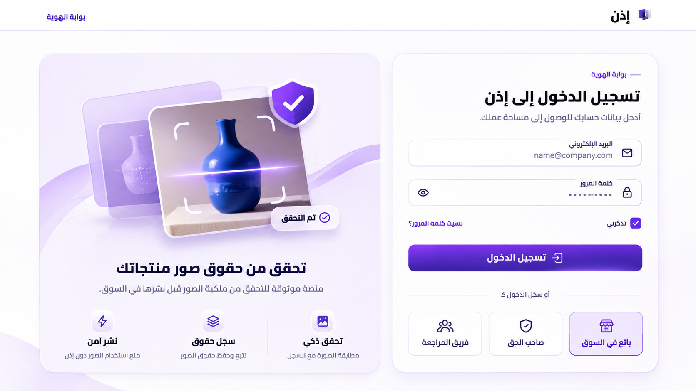

# مراجع تحسين واجهات «إذن»

تُضاف المراجع حسب ترتيب إرسالها. يبدأ التنفيذ عند طلب المستخدم «نفّذ».

## 01 — تسجيل الدخول · `/login`

### Prompt

Design a refined high-fidelity Arabic RTL web login page concept for the platform "إذن". Keep the same overall product identity and purpose, but improve the current screen substantially so it feels polished, premium, and production-ready. The page should be a desktop UI mockup with a very clean modern layout, subtle visual richness, and better composition than the current version.

Style and art direction:

- Elegant Arabic SaaS / government-tech interface
- Minimal and clean, but not empty or plain
- White is the main base color, supported by very light lavender and soft purple accents
- Add subtle background treatments: faint gradient glow, delicate line-work, soft geometric framing, and very light decorative strokes so the page feels designed, not like a plain document
- Premium, calm, trustworthy, modern
- Soft shadows, gentle borders, tasteful depth
- High readability and polished spacing

Layout:

- RTL Arabic interface
- Top navigation/header with the "إذن" logo on the right and a small breadcrumb or section label on the left
- Main hero/login card centered in a large elegant panel
- Two-column composition inside the main card:
  1) Right side: login content
  2) Left side: visual illustration / abstract brand scene

Login content requirements:

- Large Arabic heading: "تسجيل الدخول"
- Supporting text explaining that the user enters email and password to access the workspace
- Real login form fields, not just a CTA:
  - email field labeled "البريد الإلكتروني"
  - password field labeled "كلمة المرور"
- Password visibility icon inside the password field
- Primary button: "تسجيل الدخول"
- Small supporting secure-login note below
- Make the content feel complete and realistic, not empty

Illustration / visual area:

- Use an abstract branded composition inspired by layered translucent panels/cards with a small central identity symbol
- Soft purple tones, subtle line passing through the composition, and elegant depth
- Keep it visually premium and cohesive with the product identity
- It should enhance the page without overpowering the login form

Bottom information strip:

- Inside the same card, add three concise feature/value blocks with small icons:
  - "التحقق من الهوية" with a short subtitle like "دخول موثوق"
  - "تحديد الصلاحيات" with a short subtitle like "حسب دور الحساب"
  - "فتح مساحة العمل" with a short subtitle like "إجراءات المراجعة قبل النشر"
- These should look well structured and beautifully integrated

Important improvements:

- Make the page more visually rich than the current design while preserving simplicity
- Fix the feeling of emptiness by improving composition, hierarchy, decorative details, and section balance
- Ensure the result feels like a real polished website screen, not a wireframe
- Keep Arabic typography strong and elegant
- Ensure the screen looks like a realistic final UI mockup that can be handed to a developer

Output:

- Single static UI mockup
- High fidelity
- Desktop aspect ratio
- Clean Arabic typography
- No watermarks

### ملاحظة للتنفيذ لاحقًا

الصورة مرجع بصري. يظل الدور آتيًا من جلسة المصادقة وفق متطلبات المشروع. تخضع وظائف تذكّر الدخول واستعادة كلمة المرور لعقد المصادقة المعتمد.
